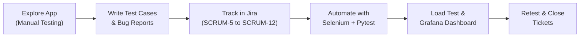

<div align="center">

# 🧪 Swag Labs — Full-Cycle QA Automation & Test Management

**End-to-end Software Quality Assurance portfolio: manual test design → Jira defect tracking → Selenium automation → performance monitoring.**


[Overview](#-overview) •
[Test Scope](#-test-scope) •
[Defects Found](#-defects-found) •
[Getting Started](#-getting-started) •
[Project Structure](#-project-structure) •
[Author](#-author)

</div>

---

## 📌 Overview

This project applies the complete **Software Testing Life Cycle (STLC)** to [Swag Labs (saucedemo.com)](https://www.saucedemo.com/), a demo e-commerce web app that intentionally hides real bugs behind different user accounts.

| Area | What was done |
| --- | --- |
| 📝 **Manual Testing & Jira** | Designed positive/negative test cases and managed them on a 4-column Scrum board (`To Do` → `In Progress` → `In Review` → `Done`) with tickets `SCRUM-5` – `SCRUM-12`. Each defect includes preconditions, steps to reproduce, priority, expected vs. actual results, and retest notes. |
| 🤖 **Web UI Automation** | Automated login, product sorting, cart, and end-to-end checkout flows using **Selenium WebDriver + Pytest**. |
| 🔌 **API Testing** | Positive and negative REST API tests with `requests` against [JSONPlaceholder](https://jsonplaceholder.typicode.com). |
| 📈 **Performance & Observability** | Simulated a load ramp-up from 10 to 500 Virtual Users and generated a Grafana-style dark-mode dashboard tracking **VUs, Throughput (RPS), p95 Latency, and Error Rate** against SLA thresholds. |

### 🔄 QA Workflow



---

## 🎯 Test Scope

Automated suite: [`06_full_test_suite_saucedemo.py`](06_full_test_suite_saucedemo.py)

| # | Test Case | Account | Expected Result |
| :-: | --- | --- | :-: |
| 01 | Locked-out user is rejected with an error message | `locked_out_user` | ✅ PASS |
| 02 | End-to-end checkout reaches *"Thank you for your order!"* | `standard_user` | ✅ PASS |
| 03 | Login completes within the 3-second SLA | `performance_glitch_user` | ❌ FAIL — bug detected |
| 04 | *Price (low to high)* sorting orders products correctly | `problem_user` | ❌ FAIL — bug detected |
| 05 | *Last Name* field accepts input on checkout | `problem_user` | ❌ FAIL — bug detected |
| 06 | *Remove* button removes the item from the cart | `problem_user` | ❌ FAIL — bug detected |
| 07 | *Finish* button completes the order | `error_user` | ❌ FAIL — bug detected |

> [!NOTE]
> **Failing tests are intentional.** Tests 03–07 are written against the *correct* expected behavior, so they fail on purpose to prove that the automation reliably catches the known defects in Swag Labs. Every failure prints a descriptive `[BUG ... TERDETEKSI!]` message with the expected vs. actual values.

---

## 🐞 Defects Found

| Ticket | Defect | Account | Priority |
| --- | --- | --- | :-: |
| `SCRUM-5` | All product thumbnails display a placeholder dog image | `problem_user` | — |
| — | Typing in *Last Name* overwrites *First Name*, blocking checkout | `problem_user` | 🔴 Highest |
| — | *Price (low to high)* sorting does not reorder products | `problem_user` | 🟠 High |
| `SCRUM-10` | *Remove* button on product cards does not remove the item | `problem_user` | 🟡 Medium |
| `SCRUM-11` | Login response time exceeds the SLA threshold (~5 s) | `performance_glitch_user` | 🟠 High |
| `SCRUM-12` | *Finish* button on Checkout Overview fails to submit the order | `error_user` | 🔴 Highest |

Full bug reports (summary, steps to reproduce, expected vs. actual) are available in [`07_daftar_todo_jira_lengkap.md`](07_daftar_todo_jira_lengkap.md).

---

## 🚀 Getting Started

### Prerequisites

- **Python 3.10+** (developed on Python 3.13)
- **Google Chrome** (Selenium 4.6+ downloads the matching ChromeDriver automatically)

### Installation

```bash
# 1. Clone the repository
git clone https://github.com/AlifNugraha17/swaglabs-qa-automation-jira.git
cd swaglabs-qa-automation-jira

# 2. (Optional) Create and activate a virtual environment
python -m venv venv
venv\Scripts\activate        # Windows
# source venv/bin/activate   # macOS / Linux

# 3. Install dependencies
pip install pytest requests selenium
```

### Running the Tests

| Goal | Command |
| --- | --- |
| Run the full Swag Labs UI suite | `pytest 06_full_test_suite_saucedemo.py -v -s` |
| Run the `SCRUM-5` image bug test | `pytest 05_latihan_web_automation_swaglabs.py -v -s` |
| Run the API tests | `pytest 03_latihan_api_testing.py -v` |
| Run the Pytest basics | `pytest 02_latihan_pytest_dasar.py -v` |
| Run a single test | `pytest 06_full_test_suite_saucedemo.py -k test_02 -v` |
| Run the load test & open the dashboard | `python 08_latihan_load_test_dan_grafana.py` |

> [!TIP]
> The UI tests open a real, visible Chrome window (maximized, incognito) so you can watch every step of the automation.

### 📊 Performance Dashboard

Running `08_latihan_load_test_dan_grafana.py` will:

1. Ramp up Virtual Users in stages: `10 → 50 → 100 → 200 → 300 → 400 → 500 → 500 → 300 → 100`.
2. Log VUs, RPS, p95 latency, and error rate for each stage in the terminal.
3. Generate [`grafana_qa_dashboard.html`](grafana_qa_dashboard.html) and open it in your browser automatically.

The dashboard shows KPI panels, a **p95 latency vs. 2000 ms SLA** chart, a **VUs & throughput** chart, and an alert banner when the SLA is breached (`SCRUM-11`).

> [!IMPORTANT]
> This is a **learning simulation**. The script sends a real request to measure baseline latency, then models the extra load per stage. For real load testing, use tools such as [Grafana k6](https://k6.io/) or [Locust](https://locust.io/) — see [`04_pengenalan_grafana_dan_load_test.md`](04_pengenalan_grafana_dan_load_test.md).

---

## 📁 Project Structure

The files are numbered as a step-by-step learning path, from QA fundamentals to performance testing.

```text
swaglabs-qa-automation-jira/
├── 01_panduan_jira_dan_manual_qa.md         # Manual QA basics, test cases & Jira bug report template
├── 02_latihan_pytest_dasar.py               # Pytest fundamentals: assertions & test discovery
├── 03_latihan_api_testing.py                # REST API testing with requests + pytest
├── 04_pengenalan_grafana_dan_load_test.md   # Performance metrics: VUs, RPS, p95, error rate
├── 05_latihan_web_automation_swaglabs.py    # Selenium test for the SCRUM-5 image bug
├── 06_full_test_suite_saucedemo.py          # Full automated UI test suite (7 test cases)
├── 07_daftar_todo_jira_lengkap.md           # Complete Jira backlog & detailed defect reports
├── 08_latihan_load_test_dan_grafana.py      # Load test simulation + Grafana-style dashboard generator
├── grafana_qa_dashboard.html                # Generated performance dashboard (output of 08)
└── README.md
```

---

## 🧰 Tech Stack

| Category | Tools |
| --- | --- |
| Language | Python 3.13 |
| UI Automation | Selenium WebDriver (Chrome) |
| Test Framework | Pytest (fixtures, assertions, `-k` filtering) |
| API Testing | Requests |
| Test Management | Jira Software (Scrum board) |
| Performance Visualization | Chart.js, Grafana-style dashboard |
| Application Under Test | [saucedemo.com](https://www.saucedemo.com/) |

---

## 👤 Author

**Alif Nugraha** — Quality Assurance Engineer

- GitHub: [@AlifNugraha17](https://github.com/AlifNugraha17)
- Focus: Manual Testing · Test Automation · Python · Selenium · Jira · Grafana

<div align="center">

⭐ If you find this project helpful, feel free to give it a star!

</div>
